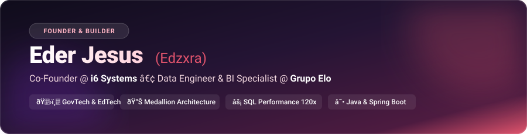

<!-- Banner Nativo em SVG (Hospedado no próprio repositório - 100% estável) -->

<!-- Texto Animado Digitado (Typing SVG) -->

  
  
  
  

---

### 💡 Quem Sou Eu & O Que Me Move

Sou **Cientista da Computação (SPTech)**, **Empreendedor** e **Especialista em Engenharia de Dados & BI**. Minha paixão é aliar a solidez da engenharia de software à inteligência analítica para construir produtos que geram impacto real na sociedade.

Atuo na intersecção entre o ecossistema de startups e o mundo corporativo:

* 🏛️ **No Empreendedorismo (i6 Systems)**: Sou **Co-proprietário e Sócio-Administrador da i6 Systems**, software house e GovTech focada em revolucionar a administração pública municipal. Desenvolvemos o **Gestor Educ** e o **AVAEE**, plataformas de impacto direto na educação regular e no **Atendimento Educacional Especializado (AEE)**.
* 📊 **No Mundo Corporativo (Grupo Elo)**: Atuo como **Analista de BI & MIS Pleno**, desenhando arquiteturas analíticas de grande escala (**Arquitetura Medallion**), pipelines autônomos em Python consumindo APIs REST/SOQL (Salesforce, Sprinklr, HugMe) e otimizando rotinas críticas em T-SQL com ganhos de até **120x em performance**.
* 🔒 **Ambientes Privados & Co-Participações**: A maior parte da minha esteira diária de commits, esteiras CI/CD e engenharia ocorre em **organizações privadas, projetos proprietários de parceiros e infraestruturas corporativas fechadas**, onde construímos soluções de missão crítica.

---

### 🚀 O Ecossistema i6 Systems: Gestor Educ & AVAEE

<table width="100%">
  <tr>
    <td width="50%" valign="top">
      <h3>🏫 Gestor Educ (GovTech & EdTech)</h3>
      
<i>Registro de Programa de Computador no INPI.</i>

      <ul>
        <li><b>Foco:</b> Modernização de secretarias municipais de educação e escolas públicas.</li>
        <li><b>Funcionalidades:</b> Gestão de matrículas, fluxo unificado de alunos, indicadores educacionais, ouvidoria e integração com o Censo Escolar.</li>
        <li><b>Objetivo:</b> Eliminar a burocracia e aproximar gestores e cidadãos com tecnologia ágil e estável.</li>
      </ul>
      

        
        
      

    </td>
    <td width="50%" valign="top">
      <h3>🧩 AVAEE / CAEE (Educação Especial Inclusiva)</h3>
      
<i>Gestão de Atendimento Educacional Especializado e Multiprofissional.</i>

      <ul>
        <li><b>Foco:</b> Suporte a alunos com necessidades especiais, neurodivergências e barreiras de aprendizagem.</li>
        <li><b>Funcionalidades:</b> Fichas pedagógicas com Semáforo de Prioridade, regulação de vagas no CAEE, anamnese do estudante/familiar, acompanhamento de PDI e prontuário eletrônico unificado com sigilo profissional.</li>
        <li><b>Equipe Integrada:</b> Psicologia, Fonoaudiologia, Terapia Ocupacional, Psicopedagogia e Professores AEE.</li>
      </ul>
      

        
        
      

    </td>
  </tr>
</table>

> 💻 **Stack das Plataformas:** React, TypeScript, Vite, Framer Motion, GSAP ScrollTrigger, Canvas 3D interativo, arquitetura modular e microsserviços.

---

### 🛠️ Minhas Ferramentas de Construção

#### 🗄️ Engenharia de Dados & Big Data

  
  
  
  
  
  
  
  

#### 📊 Business Intelligence & Storytelling

  
  
  
  
  

#### 💻 Full-Stack Development & Arquitetura

  
  
  
  
  
  
  
  

---

### 📈 Trajetória Profissional

* 🏢 **i6 Systems** | *Co-Fundador & Sócio-Administrador* `(Presente)`
  * Liderança técnica e arquitetura de ecossistemas de gestão pública e educação inclusiva (**Gestor Educ** & **AVAEE**).
* 💳 **Grupo Elo** | *Analista de BI & MIS Pleno* `(2024 - Presente)`
  * Esteiras de ingestão autônoma em Python (Salesforce Omni-Channel, Sprinklr, HugMe), Arquitetura Medallion e otimização crítica de rotinas diárias no SQL Server (~120x mais rápido).
* 🏥 **Dasa Empresas** | *Analista de Inteligência Comercial II* `(2023 - 2024)`
  * Painéis analíticos e modelos no Power BI para acompanhamento de KPIs comerciais e viabilidade estratégica.
* ⚙️ **A5 Solutions** | *Desenvolvedor Java* `(2023)`
  * Desenvolvimento backend de APIs e microsserviços em Java/Spring Boot com foco em alta disponibilidade e bancos Oracle/SQL Server.
* 🌐 **Accenture** | *Estágio em Big Data & Analytics* `(2021 - 2023)`
  * Scripts Python/HQL para processamento massivo em Data Warehouse distribuído (Hive, Impala, MongoDB) e painéis analíticos no Tableau.

---

### 🎯 Além do Código: Alta Performance & Esports

A mentalidade analítica e a disciplina de alto rendimento vêm também do cenário competitivo de games:

* 🎯 **VALORANT**: **Peak Radiante** (Top tier máximo do servidor brasileiro / Top 500) e atualmente patente **Imortal**.
* 🏆 **Fortnite**: Ex-jogador competitivo com histórico de premiações em dinheiro conquistadas (**earnings** em torneios oficiais).
* 🎮 **League of Legends**: Explorando novas lanes e aprendendo as nuances do moba nas horas de lazer.

---

### 🎓 Formação Acadêmica

* 🎓 **Bacharelado em Ciência da Computação** — *São Paulo Tech School (SPTech)* `(2020 - 2023)`
* 💻 **Técnico em Manutenção, Suporte e TI** — *Etec Jaraguá* `(2018 - 2020)`

---

  <i>"Transformando engenharia de dados, tecnologia pública e educação especializada em impacto que muda vidas."</i>

